# TGWS-Android

<p align="center">
  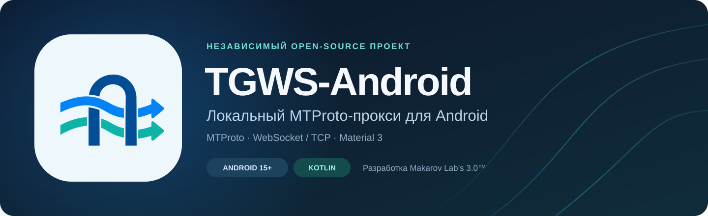
</p>

[](https://github.com/Kust3r3nk0/TGWS-Android/actions/workflows/android-ci.yml) [](https://developer.android.com/about/versions/16) [](https://kotlinlang.org/) [](LICENSE) 

**Независимый open-source порт [Flowseal/tg-ws-proxy](https://github.com/Flowseal/tg-ws-proxy) на Android 16+.** Разработка: **Makarov Lab's 3.0™**.

**[Скачать Debug APK](https://github.com/Kust3r3nk0/TGWS-Android/releases) · [English](README_EN.md) · [План развития](ROADMAP.md) · [Участие](CONTRIBUTING.md)**

> [!IMPORTANT]
> **0.6.2 — Автонастройка сети.** Явная проверка ответа MTProto и сохранение профиля сети, Debug Pre-release. [Настройка и ограничения](docs/releases/0.6.2-debug.md).

[Подготовка Release, подпись и миграция](docs/RELEASE_0.4.0.md) · [Изменения 0.4.0](docs/releases/0.4.0.md).

## 0.6.2 — Автонастройка сети

Одна кнопка проверки MTProto и сохранения профиля сети. [Настройка и ограничения](docs/releases/0.6.2-debug.md).

## 0.6.0 — Relay & Performance Update

Менеджер собственных VPS-реле, основной/резерв, ручные проверки, media-aware выбор
и исправления потоковой передачи и закрытия Node.js-реле. Существующие настройки и
ключи сохранены; менеджер включается явно. [Настройка/проверка](docs/RELAY_PERFORMANCE_0.6.0.md) ·
[VPS-развёртывание](docs/VPS_RELAY.md). Лимит Worker 16 МиБ остаётся.

## 0.5.0 — Smart Connection Update

Smart Routing, четыре сетевых профиля, Health Monitor, реальный график трафика и
необязательные уведомления. Smart включается явно; прежний режим и зашифрованные
настройки сохраняются. Новые сессии выбирают только разрешённые маршруты; действующие
не мигрируют. [Настройка, ограничения и проверка](docs/SMART_CONNECTION_0.5.0.md).
Worker сохраняет лимит 16 МиБ/сессию; уже исправленный модуль 0.4.2 менять не нужно.

## 0.4.2 — Relay Stability Fix

[Поэтапное ТЗ 0.4.2 → 0.5.0 → 0.6.0 и физическая приёмка](docs/SMART_CONNECTION_UPDATE.md).

Исправлены воспроизводимые дефекты закрытия соединений, раннего backoff и отмены при смене сети. Журнал различает HTTP Upgrade, безопасные причины Worker и закрытия отдельных сессий. Лимиты Worker сохранены; для всех изменений нужно обновить APK **и** модуль Worker. [Аудит и инструкция обновления](docs/RELAY_STABILITY_0.4.2.md). Тестовая сборка не подтверждает устойчивость внешнего узла на устройстве.

## Новое тестовое обновление 0.4.1

Категории и уровни ошибок, фильтры, подробности закрытия маршрутов, ограничение повторов, безопасный JSON-отчёт и локальная проверка TCP-порта. В диагностике отображается фактический системный WebView-провайдер и версия без запуска браузерного движка. [Изменения и ограничения](docs/releases/0.4.1.md). CI пройден: 270 JVM-тестов и по 61 Android-тесту на API 36/37. [Как пользоваться диагностикой](docs/DIAGNOSTICS.md).

<table><tr><td>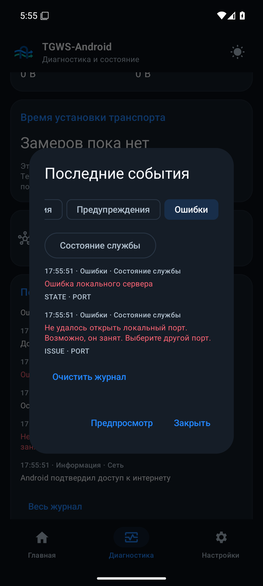</td><td>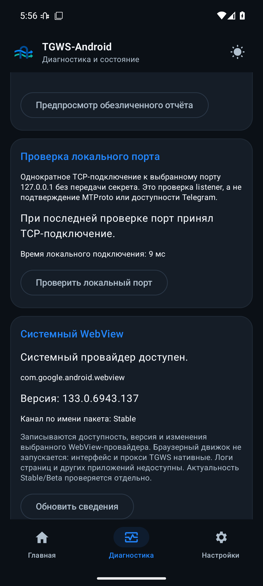</td></tr></table>

Реальные снимки 0.4.1 на CI-эмуляторе API 36: воспроизведён занятый порт и проверен действующий локальный listener. Показан фактически установленный WebView, без сертификации latest. [Источник](docs/VERIFICATION_0.4.1.md).

## Языки и технологии

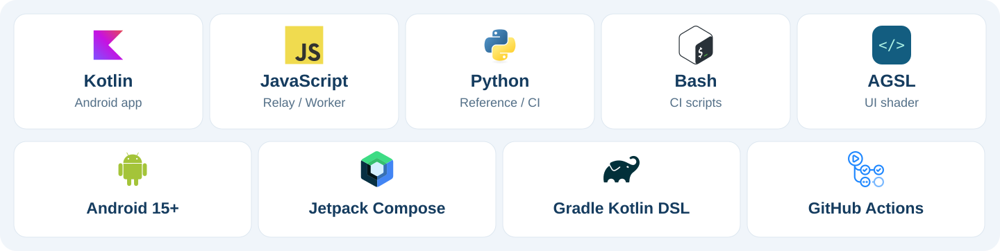

| Язык | Для чего используется |
| --- | --- |
| **Kotlin** | Нативное Android-приложение, MTProto-ядро, интерфейс Jetpack Compose и тесты |
| **JavaScript · ES modules** | Собственное WSS-реле и Cloudflare Worker: каталоги `relay/` и `cloudflare-worker/` |
| **Python 3** | Эталонные протокольные векторы, проверки и публикация CI; **в APK не входит** |
| **Bash** | Запуск Android-инструментальных тестов и подготовка эмулятора в CI |
| **AGSL** | Встроенный Android RuntimeShader для Liquid Glass и эффекта прозрачности в `LiquidGlass.kt` |

**Ресурсы и конфигурация:** XML — AndroidManifest, иконки и локализация; Kotlin DSL —
Gradle-сборка; YAML/JSON — workflows и серверные настройки. Java используется как JDK 17,
отдельных Java-исходников в текущем проекте нет.

**Платформа:** Android 16+, Jetpack Compose / Material 3, Kotlin Coroutines, OkHttp,
Android Keystore, Gradle и GitHub Actions. [Источники изображений и лицензии](docs/images/ASSETS.md).

## Premium Minimal в приложении

<table>
  <tr><td align="center" width="33%"><strong>Главная</strong></td><td align="center" width="33%"><strong>Диагностика</strong></td><td align="center" width="33%"><strong>Настройки</strong></td></tr>
  <tr><td>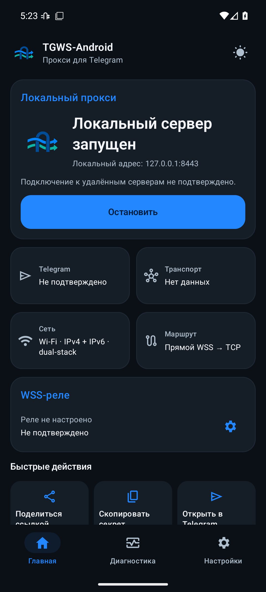</td><td>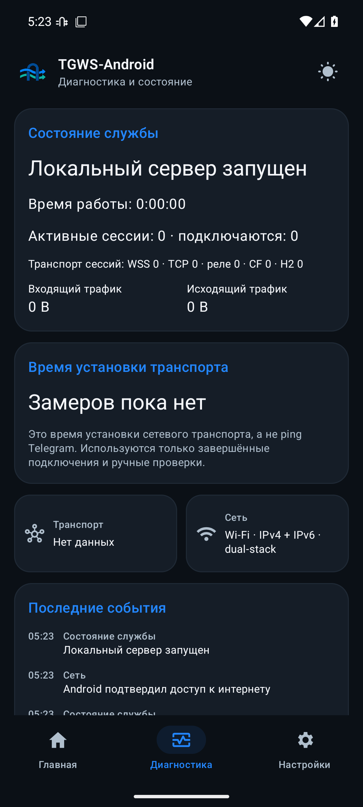</td><td>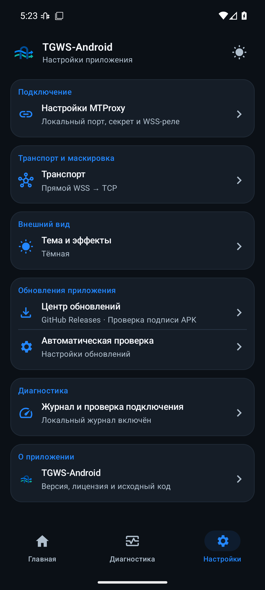</td></tr>
  <tr><td>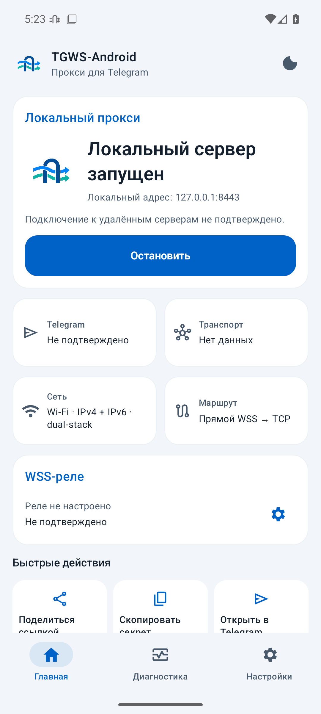</td><td>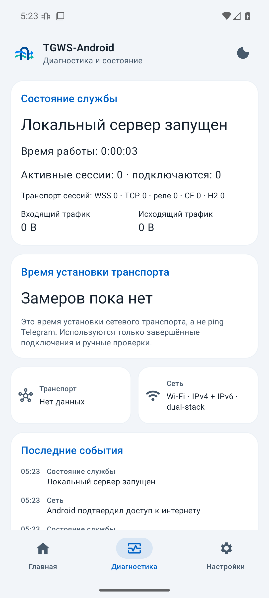</td><td>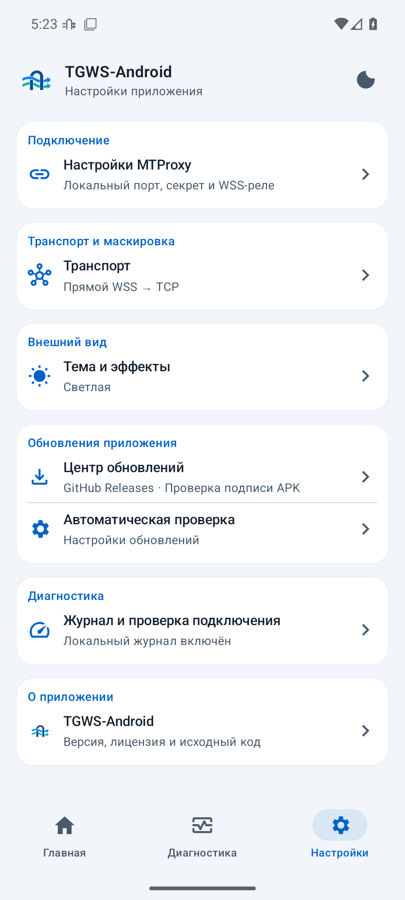</td></tr>
</table>

Реальные снимки кандидата **0.4.0**, API 36, русский интерфейс. Локальный listener запущен; удалённое подключение и измерения не имитируются. [Источник, проверки и ограничения](docs/VERIFICATION_0.4.0.md).

## Интерфейс и системный DNS

В нижнем меню три вкладки: **Главная**, **Диагностика**, **Настройки**. Параметры подключения, транспорта, оформления и обновлений вынесены в подразделы. Светлая/тёмная/системная тема сохраняется;
кнопка в верхнем меню быстро переключает светлый и тёмный режим. UI использует Material 3.
В разделе «Оформление» доступен **Liquid Glass · бета**: стеклянные панели и навигация
в обеих темах. По умолчанию выключен; выбор сохраняется и применяется сразу.
Рядом добавлен отдельный **«Эффект прозрачности»**: фон приложения действительно виден
сквозь карточки и панели. Можно включить без Liquid Glass или вместе с ним; по умолчанию выключен.

Встроенный **Cloudflare DNS удалён**. Используется DNS активной сети Android, включая
системный Private DNS и операторские DNS64-ответы; остальные настройки сохраняются.
Добавлен ограниченный параллельный выбор IPv4/IPv6 с шагом 250 мс. Главная автоматически
показывает Wi-Fi/мобильную сеть и семейства адресов, даже когда прокси остановлен.
[DNS и ограничения](docs/DNS_AND_APPEARANCE.md) · [Почему сеть может не работать и варианты](docs/NETWORK_COMPATIBILITY_0.3.4.md).

## Как работает TGWS-Android

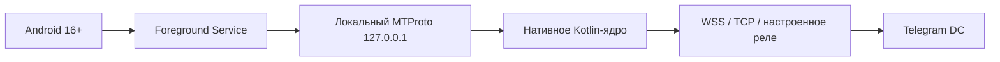

*Схема показывает нативный тракт. Доступность внешних маршрутов проверяется отдельно.*

## О проекте

TGWS-Android — нативное Android-приложение на Kotlin и Jetpack Compose для запуска локального MTProto WebSocket-прокси. Планируется функциональная совместимость с сетевым ядром Flowseal TG-WS-Proxy, включая WebSocket, TCP fallback, Fake TLS, Cloudflare-маршруты и HTTP/2. Приложение **не является VPN** и не перехватывает системный трафик.

## Сетевое поведение и ограничения

- Fake TLS и обычный Obfuscated2 с тем же секретом доступны на одном локальном listener; неверные секреты отклоняются.
- Крупные передачи в обоих направлениях обновляют сроки по полезному продвижению; границы памяти и зависания сохранены.
- Приостановка и блокировка той же Android-сети закрывают старые сессии, чтобы Telegram мог подключиться заново.
- Прежний экспериментальный Worker сохраняет лимит 16 МиБ/сессию. Доступность внешнего узла зависит от сети.

[План исправлений](ROADMAP.md). Встроенного WebView нет; сетевое ядро нативное.

## Версии Android и сборочные инструменты

- **Android:** minSdk 36 (Android 16); compileSdk 37.0 / targetSdk 37. Поддерживаются только API 36 и новее.
- **Kotlin:** 2.4.21; **AGP:** 9.4.1; **Gradle Wrapper:** 9.8.1 с проверкой SHA-256.
- **UI:** Jetpack Compose / Material 3; Java bytecode target 17.
- **Без Python в APK:** Python из оригинального проекта используется только для эталонных тестов совместимости.
- **ABI:** APK формируется для совместимых Android-устройств, включая ARM64; отдельного NDK-кода пока нет.

Версии зафиксированы для воспроизводимости. Изменения зависимостей допускаются после проверки совместимости в CI.

## Сборка для разработчиков

1. Установите Android Studio с поддержкой AGP 9.4, JDK 17, Android SDK `platforms;android-37.0` и `build-tools;36.0.0`.
2. Клонируйте этот репозиторий и откройте его в Android Studio.
3. Для сборки в терминале используйте комплектный Gradle Wrapper: `./gradlew :app:assembleDebug` (Linux/macOS) или `gradlew.bat :app:assembleDebug` (Windows).
4. Основная проверка: `./gradlew --no-daemon :app:testDebugUnitTest :app:lintDebug :app:assembleDebug`.
5. Сборка инструментальных тестов: `./gradlew --no-daemon :app:assembleDebugAndroidTest`; выполнение на устройстве: `./gradlew --no-daemon :app:connectedDebugAndroidTest`.
6. Debug APK доступен в **Actions → Android CI → запуск → Artifacts**. [Инструкции Codex](AGENTS.md).

> [!NOTE]
> Обязательные проверки: JVM-тесты, Lint и сборка APK; CI выполняет инструментальные тесты и проверку обновления APK на API 36–37. [Проверки для разработчиков](docs/TESTING.md).

CI запускается при push в `main`, Pull Request и вручную. Успешная проверка
публикует debug APK, `SHA256SUMS`, версию и commit, changelog; отчёты JVM/Lint
сохраняются отдельно. Actions и Wrapper закреплены по проверенным SHA.
Отдельный workflow при PR и вручную проверяет Android API 36 и 37.0.

[Скачать 0.4.1 Debug APK](https://github.com/Kust3r3nk0/TGWS-Android/releases)

## Транспорты 0.3.0

[Настройка direct / relay-only / Auto CF, Fake TLS и H2](docs/TRANSPORTS_0.3.md).
[Российские операторы, APN-справочник и матрица](docs/RU_MOBILE_OPERATORS.md).
Прежние настройки мигрируют с сохранением режима; автоматическая смена APN, DNS и SIM не выполняется.

## Надёжность 0.2.0

Добавлены ограниченный пул свежих прямых WSS-подключений, Ping/Pong перед выдачей,
ротация и backoff 1–30 с. Активные MTProto-сессии не переиспользуются.
[Политика, нагрузочный стенд и ограничения](docs/RELIABILITY_0.2.md).

## Мобильные сети

Если оператор блокирует IP Telegram, прямой WSS → TCP может не помочь.
Начиная с 0.1.3-alpha можно указать собственное WSS-реле на доступном внешнем узле.
Доступность прямых маршрутов и реле зависит от текущей сети; конкретный узел проверяется отдельно.
[Настройка, сервер реле и ограничения](docs/MOBILE_NETWORKS.md).

Для пробы через Cloudflare без VPS: [Worker и инструкция](cloudflare-worker/README.md).
Нужен аккаунт Cloudflare; доступность Worker зависит от сети и настроенного узла. Это отдельная
экспериментальная заготовка с лимитом 16 MiB на сессию, не новый APK и не
подтверждённый обход. Подстановка SNI `cloudflare.com` не создаёт рабочий узел.

## Поведение альфы

Listener принимает только `127.0.0.1`; порт по умолчанию — `1443`. Запуск
сервиса выполняется действием пользователя. Открытый локальный порт не означает
подключение Telegram: экран отдельно показывает ожидающие и установленные
транспортные сессии. Счётчик не подтверждает отправку сообщения.

WSS использует обычную проверку доверия TLS и имени `kwsN.web.telegram.org`.
По умолчанию upstream задаёт WSS redirect `149.154.167.220` для DC 2 и 4;
остальные DC идут по прямому TCP. Media сначала пробует `kwsN-1`, затем `kwsN`.
Существующий DC 203 сохранён как отдельный TCP-маршрут. Тестовые DC `10001–10005`
отклоняются. Fronting с отключением проверки имени сервера не переносится.

Секрет скрыт по умолчанию. Отображение, копирование и открытие Telegram-ссылки
требуют действия пользователя; ссылка использует `dd` для Padded Intermediate.
Для Fake TLS укажите домен: ссылка использует `ee` + secret + HEX домена. Локальная маскировка не заменяет удалённый TLS и не снимает IP-блокировку сама по себе. Ciphertext сохранённого секрета не заменяется
молча при утрате ключа Keystore. Диагностика содержит только категории событий.

После 60 с тишины WSS проверяет peer через Ping/Pong, вместо немедленного
разрыва. Срок сборки неполного сообщения — 60 с; MTProto-сессия без полезной
активности ограничена 300 с. На экране отдельно видны активные WSS/TCP-сессии;
прошлая ошибка fallback снимается при успешном новом соединении.

При смене сети существующие сессии закрываются; Telegram должен создать новые.
Бесшовной миграции нет. Полные критерии, ограничения и фактически выполненные
проверки приведены в [Проверки для разработчиков](docs/TESTING.md).

## Архитектура исходников

```text
app/src/main/java/io/github/kust3r3nk0/tgwsandroid/
├── MainActivity.kt        # Экран управления
├── ProxyService.kt        # Android foreground service
├── ProxyState.kt          # Состояние сервиса
├── SettingsStore.kt       # Keystore и настройки
└── core/
    ├── MtprotoCrypto.kt   # Обфускация и AES-CTR
    ├── MtprotoServer.kt   # Локальный listener, мост, TCP fallback
    ├── PacketSplitter.kt  # Пакетные границы MTProto
    └── RawWebSocket.kt    # WebSocket-клиент
```

## Совместимость с Flowseal

- Оригинальный проект: [Flowseal/tg-ws-proxy](https://github.com/Flowseal/tg-ws-proxy).
- Эталонная версия: **v1.11.2**, commit `307a384ab7f522e34bb1a045884d0bd90f40bee5`.
- Мы не представляем и не аффилированы с официальными сопровождающими оригинала. Это независимая реализация, созданная на основе открытого кода и протокольного поведения проекта.
- Attribution и условия лицензирования: [LICENSE](LICENSE) и [NOTICE.md](NOTICE.md).

## Open Source

Код распространяется по лицензии **MIT**. Приветствуются сообщения об ошибках, тестирование и Pull Requests. Перед внесением изменений ознакомьтесь с [CONTRIBUTING.md](CONTRIBUTING.md) и [SECURITY.md](SECURITY.md).

**Разработчик / инициатор проекта:** Makarov Lab's 3.0™.
**Репозиторий:** `Kust3r3nk0/TGWS-Android`.


## WebView и проверки владельцем

Интерфейс нативный Compose: встроенного WebView и зависимости WebKit нет. Инвентаризация
провайдера в CI не подтверждает latest Stable/Beta. [WebView-контракт](docs/TGWS-16-016_WEBVIEW.md)
и [порядок физических проверок](docs/TGWS-16-017_PHYSICAL_TESTING.md) закрепляют обязанности.
Успешные CI-артефакты содержат версию, source/tree SHA и `BUILD.md`; результаты
на смартфоне, One UI, у оператора, в Telegram и Stable/Beta подтверждает владелец.

## Update Center

[Нативный центр обновлений](docs/UPDATE_CENTER.md): GitHub Releases, Stable/Preview, WorkManager и проверка подписи APK. Настройки доступны в отдельном разделе приложения.

[Настоящие экраны Update Center и автоматические проверки](docs/UPDATE_CENTER_VERIFICATION.md).
