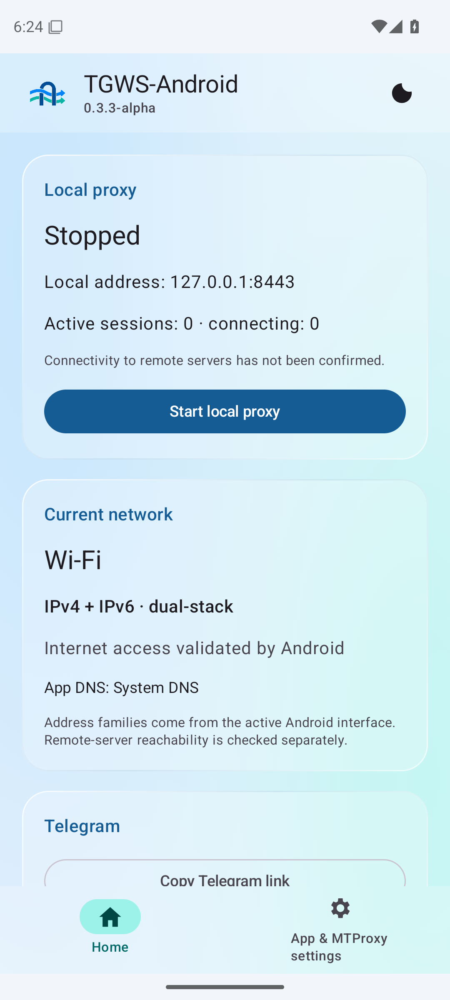
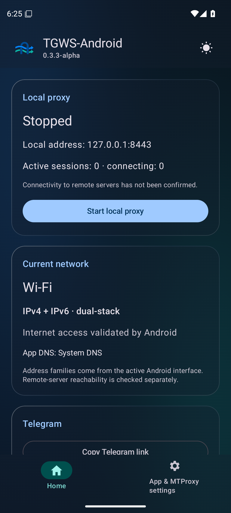
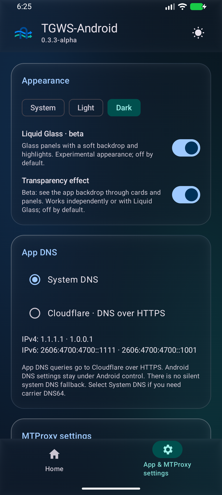

# TGWS-Android

<p align="center">
  
</p>

[](https://github.com/Kust3r3nk0/TGWS-Android/actions/workflows/android-ci.yml) [](https://developer.android.com/about/versions/16) [](https://kotlinlang.org/) [](LICENSE) 

**Независимый open-source порт [Flowseal/tg-ws-proxy](https://github.com/Flowseal/tg-ws-proxy) на Android 16+.** Разработка: **Makarov Lab's 3.0™**.

**[Скачать Debug APK](https://github.com/Kust3r3nk0/TGWS-Android/releases/download/v0.3.5-alpha-debug/TGWS-Android-0.3.5-debug.apk) · [English](README_EN.md) · [План развития](ROADMAP.md) · [Результаты тестов](docs/TEST_REPORT_0.3.5-alpha.md) · [Участие](CONTRIBUTING.md)**

> [!IMPORTANT]
> **0.3.5-alpha — тестовая сборка с прежней debug-подписью.** CI: 203 JVM-теста, по 33 Android-теста на API 36/37 и обновление поверх 0.3.4 с сохранением секрета/настроек. Проверка этой версии с Telegram и мобильным оператором на физическом устройстве ожидается.

## Языки и технологии


| Язык | Для чего используется |
| --- | --- |
| **Kotlin** | Нативное Android-приложение, MTProto-ядро, интерфейс Jetpack Compose и тесты |
| **JavaScript · ES modules** | Собственное WSS-реле и Cloudflare Worker: каталоги `relay/` и `cloudflare-worker/` |
| **Python 3** | Эталонные протокольные векторы, проверки и публикация CI; **в APK не входит** |
| **Bash** | Запуск Android-инструментальных тестов и подготовка эмулятора в CI |
| **AGSL** | Встроенный Android RuntimeShader для Liquid Glass и эффекта прозрачности в `LiquidGlass.kt` |

**Ресурсы и конфигурация:** XML — AndroidManifest, иконки и локализация; Kotlin DSL —
Gradle-сборка; YAML/JSON — workflows и серверные настройки. Java используется как JDK 17,
отдельных Java-исходников в текущем проекте нет.

**Платформа:** Android 16+, Jetpack Compose / Material 3, Kotlin Coroutines, OkHttp,
Android Keystore, Gradle и GitHub Actions. [Источники изображений и лицензии](docs/images/ASSETS.md).

## Приложение в кадре

<table>
  <tr>
    <td align="center" width="33%"><strong>Светлая тема</strong></td>
    <td align="center" width="33%"><strong>Тёмная тема</strong></td>
    <td align="center" width="33%"><strong>Оформление</strong></td>
  </tr>
  <tr>
    <td></td>
    <td></td>
    <td></td>
  </tr>
</table>

Исторические снимки **0.3.3-alpha** из CI (не матрица текущей поддержки): Android API 35/36/37, английская локализация,
программный GPU. Для демонстрации включены бета-эффекты; по умолчанию они выключены.
Снимки не подтверждают соединение Telegram. [Источник и проверенные SHA-256](docs/images/ASSETS.md).

## Интерфейс и системный DNS

В нижнем меню две вкладки: **Главная страница** (запуск, Telegram, сеть) и
**Настройки приложения и MTProxy**. Светлая/тёмная/системная тема сохраняется;
кнопка в верхнем меню быстро переключает светлый и тёмный режим. UI использует Material 3.
В разделе «Оформление» доступен **Liquid Glass · бета**: стеклянные панели и навигация
в обеих темах. По умолчанию выключен; выбор сохраняется и применяется сразу.
Рядом добавлен отдельный **«Эффект прозрачности»**: фон приложения действительно виден
сквозь карточки и панели. Можно включить без Liquid Glass или вместе с ним; по умолчанию выключен.

Встроенный **Cloudflare DNS удалён**. Используется DNS активной сети Android, включая
системный Private DNS и операторские DNS64-ответы; остальные настройки сохраняются.
Добавлен ограниченный параллельный выбор IPv4/IPv6 с шагом 250 мс. Главная автоматически
показывает Wi-Fi/мобильную сеть и семейства адресов, даже когда прокси остановлен.
[DNS и ограничения](docs/DNS_AND_APPEARANCE.md) · [Почему сеть может не работать и варианты](docs/NETWORK_COMPATIBILITY_0.3.4.md).

## Как работает TGWS-Android


*Схема показывает текущую архитектуру исходников 0.1.0-alpha и запланированные возможности версии 1.0. Изображение не означает, что все функции уже реализованы или протестированы.*

## О проекте

TGWS-Android — нативное Android-приложение на Kotlin и Jetpack Compose для запуска локального MTProto WebSocket-прокси. Планируется функциональная совместимость с сетевым ядром Flowseal TG-WS-Proxy, включая WebSocket, TCP fallback, Fake TLS, Cloudflare-маршруты и HTTP/2. Приложение **не является VPN** и не перехватывает системный трафик.

## Текущее состояние (0.3.5-alpha)

| Возможность | Статус |
|---|---|
| Obfuscated2, AES-CTR, relay initialization | Реализовано и протестировано: побайтовые JVM-векторы Flowseal v1.11.2 |
| Abridged, Intermediate, Padded Intermediate | Реализовано и протестировано: JVM, пакет до 4 МиБ, повреждённые длины отклоняются |
| Локальный listener и WSS → TCP fallback | Реализовано и протестировано: локальные интеграционные тесты; публичная сеть Telegram требует проверки |
| WebSocket framing, HTTP Upgrade, TLS | Реализовано и протестировано: локальные RFC 6455 / TLS тесты; реальные WSS-узлы требуют проверки |
| Foreground Service, реакция на потерю сети | Основной lifecycle протестирован на эмуляторах API 36–37; реальные Wi-Fi/LTE требуют проверки |
| Compose / Material 3, русский и английский UI | Протестировано на API 36–37; физическая проверка ожидается |
| Android Keystore AES-256-GCM | API 36–37, включая обновление 0.3.4 → 0.3.5; утрата ключа/записи требует явного восстановления |
| Реальное подключение официального Telegram | Исторические сообщения/SD подтверждены владельцем; HD зависает на 0.3.4/LTE/Worker. Новая 0.3.5 требует проверки |
| Собственное WSS-реле (Worker-совместимое) | Реализовано и протестировано локально; нужен внешний узел, мобильный E2E не проверен |
| Fake TLS (ee-secret) | Реализовано и протестировано: HMAC/records и локальные сессии; внешний E2E не проверен |
| Cloudflare Proxy и Worker fallback | Реализовано и протестировано локально: проверяемая конфигурация, ротация/backoff; нужен совместимый внешний узел |
| HTTP/2 для медиатрафика | Реализовано и протестировано с локальным TLS/H2 `/api`, multiplexing/flow control/RST/GOAWAY; внешний E2E не проверен |
| IPv4/IPv6 и смена сети | Реализовано и протестировано в моделях/локальных тестах; DNS64/XLAT зависят от ОС и сети, физическая проверка ожидается |
| Диагностика и справочник операторов | Реализовано: состояния маршрутов/сети, реальные замеры, явная проверка и обезличенный экспорт |
| Debug APK | Тестовый артефакт с отладочной подписью; не пользовательский релиз |
| GitHub debug-предрелизы | Разрешены владельцем; публикуются после CI, с отладочной подписью и ограничениями |
| Доверенно подписанный стабильный APK | Запланировано; полный release gate не пройден |

## Версии Android и сборочные инструменты

- **Android:** minSdk 36 (Android 16); compileSdk 37.0 / targetSdk 37. Android 14/15 не поддерживаются.
- **Kotlin:** 2.4.21; **AGP:** 9.4.1; **Gradle Wrapper:** 9.8.1 с проверкой SHA-256.
- **UI:** Jetpack Compose / Material 3; Java bytecode target 17.
- **Без Python в APK:** Python из оригинального проекта используется только для эталонных тестов совместимости.
- **ABI:** APK формируется для совместимых Android-устройств, включая ARM64; отдельного NDK-кода пока нет.

Версии зафиксированы для воспроизводимости. Изменения зависимостей допускаются после проверки совместимости в CI.

## Сборка для разработчиков

1. Установите Android Studio с поддержкой AGP 9.4, JDK 17, Android SDK `platforms;android-37.0` и `build-tools;36.0.0`.
2. Клонируйте этот репозиторий и откройте его в Android Studio.
3. Для сборки в терминале используйте комплектный Gradle Wrapper: `./gradlew :app:assembleDebug` (Linux/macOS) или `gradlew.bat :app:assembleDebug` (Windows).
4. Основная проверка: `./gradlew --no-daemon :app:testDebugUnitTest :app:lintDebug :app:assembleDebug`.
5. Сборка инструментальных тестов: `./gradlew --no-daemon :app:assembleDebugAndroidTest`; выполнение на устройстве: `./gradlew --no-daemon :app:connectedDebugAndroidTest`.
6. Debug APK доступен в **Actions → Android CI → запуск → Artifacts**. [Инструкции Codex](AGENTS.md).

> [!NOTE]
> Обязательные проверки: JVM-тесты, Lint и сборка APK; CI выполняет инструментальные тесты и проверку обновления APK на API 36–37. [Результаты и ограничения](docs/TEST_REPORT_0.3.5-alpha.md).

CI запускается при push в `main`, Pull Request и вручную. Успешная проверка
публикует debug APK, `SHA256SUMS`, версию и commit, changelog; отчёты JVM/Lint
сохраняются отдельно. Actions и Wrapper закреплены по проверенным SHA.
Отдельный workflow при PR и вручную проверяет Android API 36 и 37.0.

[Скачать 0.3.5 Debug APK](https://github.com/Kust3r3nk0/TGWS-Android/releases/download/v0.3.5-alpha-debug/TGWS-Android-0.3.5-debug.apk)

## Транспорты 0.3.0

[Настройка direct / relay-only / Auto CF, Fake TLS и H2](docs/TRANSPORTS_0.3.md).
[Российские операторы, APN-справочник и матрица](docs/RU_MOBILE_OPERATORS.md).
Прежние настройки мигрируют с сохранением режима; автоматическая смена APN, DNS и SIM не выполняется.

## Надёжность 0.2.0

Добавлены ограниченный пул свежих прямых WSS-подключений, Ping/Pong перед выдачей,
ротация и backoff 1–30 с. Активные MTProto-сессии не переиспользуются.
[Политика, нагрузочный стенд и ограничения](docs/RELIABILITY_0.2.md).

## Мобильные сети

Если оператор блокирует IP Telegram, прямой WSS → TCP может не помочь.
Начиная с 0.1.3-alpha можно указать собственное WSS-реле на доступном внешнем узле.
Реле не развёртывается автоматически; его доступность у оператора ещё не проверена.
[Настройка, сервер реле и ограничения](docs/MOBILE_NETWORKS.md).

Для пробы через Cloudflare без VPS: [Worker и инструкция](cloudflare-worker/README.md).
Нужен аккаунт Cloudflare; доступность у Мегафона ещё не проверена. Это отдельная
экспериментальная заготовка с лимитом 16 MiB на сессию, не новый APK и не
подтверждённый обход. Подстановка SNI `cloudflare.com` не создаёт рабочий узел.

## Поведение альфы

Listener принимает только `127.0.0.1`; порт по умолчанию — `1443`. Запуск
сервиса выполняется действием пользователя. Открытый локальный порт не означает
подключение Telegram: экран отдельно показывает ожидающие и установленные
транспортные сессии. Счётчик не подтверждает отправку сообщения.

WSS использует обычную проверку доверия TLS и имени `kwsN.web.telegram.org`.
По умолчанию upstream задаёт WSS redirect `149.154.167.220` для DC 2 и 4;
остальные DC идут по прямому TCP. Media сначала пробует `kwsN-1`, затем `kwsN`.
Существующий DC 203 сохранён как отдельный TCP-маршрут. Тестовые DC `10001–10005`
отклоняются. Fronting с отключением проверки имени сервера не переносится.

Секрет скрыт по умолчанию. Отображение, копирование и открытие Telegram-ссылки
требуют действия пользователя; ссылка использует `dd` для Padded Intermediate.
Для Fake TLS укажите домен: ссылка использует `ee` + secret + HEX домена. Локальная маскировка не заменяет удалённый TLS и не снимает IP-блокировку сама по себе. Ciphertext сохранённого секрета не заменяется
молча при утрате ключа Keystore. Диагностика содержит только категории событий.

После 60 с тишины WSS проверяет peer через Ping/Pong, вместо немедленного
разрыва. Срок сборки неполного сообщения — 60 с; MTProto-сессия без полезной
активности ограничена 300 с. На экране отдельно видны активные WSS/TCP-сессии;
прошлая ошибка fallback снимается при успешном новом соединении.

При смене сети существующие сессии закрываются; Telegram должен создать новые.
Бесшовной миграции нет. Полные критерии, ограничения и фактически выполненные
проверки приведены в [отчёте обновления](docs/TEST_REPORT_0.3.5-alpha.md).

## Архитектура исходников

```text
app/src/main/java/io/github/kust3r3nk0/tgwsandroid/
├── MainActivity.kt        # Экран управления
├── ProxyService.kt        # Android foreground service
├── ProxyState.kt          # Состояние сервиса
├── SettingsStore.kt       # Keystore и настройки
└── core/
    ├── MtprotoCrypto.kt   # Обфускация и AES-CTR
    ├── MtprotoServer.kt   # Локальный listener, мост, TCP fallback
    ├── PacketSplitter.kt  # Пакетные границы MTProto
    └── RawWebSocket.kt    # WebSocket-клиент
```

## Совместимость с Flowseal

- Оригинальный проект: [Flowseal/tg-ws-proxy](https://github.com/Flowseal/tg-ws-proxy).
- Эталонная версия: **v1.11.2**, commit `307a384ab7f522e34bb1a045884d0bd90f40bee5`.
- Мы не представляем и не аффилированы с официальными сопровождающими оригинала. Это независимая реализация, созданная на основе открытого кода и протокольного поведения проекта.
- Attribution и условия лицензирования: [LICENSE](LICENSE) и [NOTICE.md](NOTICE.md).

## Open Source

Код распространяется по лицензии **MIT**. Приветствуются сообщения об ошибках, тестирование и Pull Requests. Перед внесением изменений ознакомьтесь с [CONTRIBUTING.md](CONTRIBUTING.md) и [SECURITY.md](SECURITY.md).

**Разработчик / инициатор проекта:** Makarov Lab's 3.0™.  
**Репозиторий:** `Kust3r3nk0/TGWS-Android`.


## WebView и проверки владельцем

Интерфейс нативный Compose: встроенного WebView и зависимости WebKit нет. Инвентаризация
провайдера в CI не подтверждает latest Stable/Beta. [WebView-контракт](docs/TGWS-16-016_WEBVIEW.md)
и [порядок физических проверок](docs/TGWS-16-017_PHYSICAL_TESTING.md) закрепляют обязанности.
Успешные CI-артефакты содержат версию, source/tree SHA и `OWNER_HANDOFF.md`; результаты
на смартфоне, One UI, у оператора, в Telegram и Stable/Beta подтверждает владелец.
