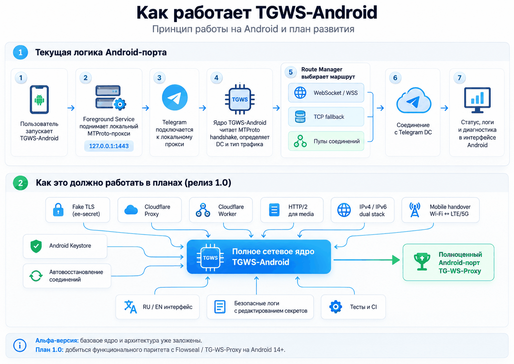

# TGWS-Android

[](https://github.com/Kust3r3nk0/TGWS-Android/actions/workflows/android-ci.yml)

[](https://developer.android.com/about/versions/14)
[](https://kotlinlang.org/)
[](LICENSE)


**Независимый open-source порт [Flowseal/tg-ws-proxy](https://github.com/Flowseal/tg-ws-proxy) на Android 14+.** Разработка: **Makarov Lab's 3.0™**.

**[English README](README_EN.md) · [План разработки](ROADMAP.md) · [Помощь проекту](CONTRIBUTING.md)**

> [!IMPORTANT]
> **Ранняя альфа-версия.** Это не готовый релиз, не подтверждённый рабочий прокси и не полная замена оригинального проекта. Android-сборка и базовые JVM-тесты прошли CI; реальное соединение с серверами Telegram пока **не проверено**. Не используйте эту версию как единственный канал связи.

## Как работает TGWS-Android



*Схема показывает текущую архитектуру исходников 0.1.0-alpha и запланированные возможности версии 1.0. Изображение не означает, что все функции уже реализованы или протестированы.*

## О проекте

TGWS-Android — нативное Android-приложение на Kotlin и Jetpack Compose для запуска локального MTProto WebSocket-прокси. Планируется функциональная совместимость с сетевым ядром Flowseal TG-WS-Proxy, включая WebSocket, TCP fallback, Fake TLS, Cloudflare-маршруты и HTTP/2. Приложение **не является VPN** и не перехватывает системный трафик.

## Текущее состояние (0.1.0-alpha)

| Возможность | Статус |
|---|---|
| Нативный Kotlin UI на Jetpack Compose | Android CI собирает приложение; тесты на устройстве ещё нужны |
| Локальный MTProto listener (127.0.0.1:1443) | Базовая реализация, требует E2E-тестирования |
| Obfuscated2 и AES-CTR | Код и базовые тесты |
| Прямой WebSocket / WSS | Код, требует интеграционных тестов |
| Прямой TCP fallback | Код, требует интеграционных тестов |
| Android Keystore | Базовая реализация |
| Fake TLS (ee-secret) | Запланировано |
| Cloudflare Proxy, Worker и балансировка | Запланировано |
| HTTP/2 для медиатрафика | Запланировано |
| IPv6-only, миграция сетей, тестовые DC | Запланировано |
| APK/AAB и подписанные релизы | Нет |

## Технологии

- **Android:** minSdk 34 (Android 14); compileSdk/targetSdk 37.
- **Kotlin:** 2.4.21 (стабильный релиз); **AGP:** 9.4.0; **Gradle:** 9.8.1.
- **UI:** Jetpack Compose / Material 3; Java bytecode target 17.
- **Без Python в APK:** Python из оригинального проекта используется только для эталонных тестов совместимости.
- **ABI:** APK формируется для совместимых Android-устройств, включая ARM64; отдельного NDK-кода пока нет.

Версии зафиксированы для воспроизводимости. Изменения зависимостей допускаются после проверки совместимости в CI.

## Сборка для разработчиков

1. Установите Android Studio с поддержкой AGP 9.4, JDK 17, Android SDK Platform 37.
2. Клонируйте этот репозиторий и откройте его в Android Studio.
3. Для сборки в терминале используйте комплектный Gradle Wrapper: `./gradlew :app:assembleDebug` (Linux/macOS) или `gradlew.bat :app:assembleDebug` (Windows).
4. Для проверки используйте `./gradlew :app:testDebugUnitTest :app:lintDebug`.

> [!NOTE]
> Это инструкции для воспроизведения сборки, **не подтверждение успешного Android CI**. Публичная CI-сборка подтверждает компиляцию и базовые проверки, но не работу прокси с реальными серверами Telegram.

## Архитектура исходников

```text
app/src/main/java/io/github/kust3r3nk0/tgwsandroid/
├── MainActivity.kt        # Экран управления
├── ProxyService.kt        # Android foreground service
├── ProxyState.kt          # Состояние сервиса
├── SettingsStore.kt       # Keystore и настройки
└── core/
    ├── MtprotoCrypto.kt   # Обфускация и AES-CTR
    ├── MtprotoServer.kt   # Локальный listener, мост, TCP fallback
    ├── PacketSplitter.kt  # Пакетные границы MTProto
    └── RawWebSocket.kt    # WebSocket-клиент
```

## Совместимость с Flowseal

- Оригинальный проект: [Flowseal/tg-ws-proxy](https://github.com/Flowseal/tg-ws-proxy).
- Эталонная версия: **v1.11.2**, commit `307a384ab7f522e34bb1a045884d0bd90f40bee5`.
- Мы не представляем и не аффилированы с официальными сопровождающими оригинала. Это независимая реализация, созданная на основе открытого кода и протокольного поведения проекта.
- Attribution и условия лицензирования: [LICENSE](LICENSE) и [NOTICE.md](NOTICE.md).

## Open Source

Код распространяется по лицензии **MIT**. Приветствуются сообщения об ошибках, тестирование и Pull Requests. Перед внесением изменений ознакомьтесь с [CONTRIBUTING.md](CONTRIBUTING.md) и [SECURITY.md](SECURITY.md).

**Разработчик / инициатор проекта:** Makarov Lab's 3.0™.  
**Репозиторий:** `Kust3r3nk0/TGWS-Android`.
