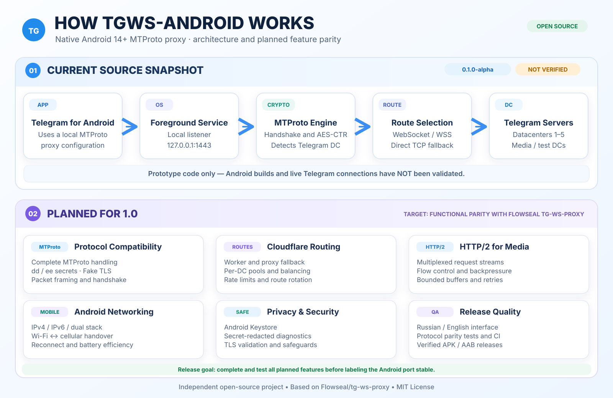

# TGWS-Android

[](https://github.com/Kust3r3nk0/TGWS-Android/actions/workflows/android-ci.yml)

**Unofficial, open-source Android 14+ port of [Flowseal/tg-ws-proxy](https://github.com/Flowseal/tg-ws-proxy).** Developed under **Makarov Lab's 3.0™**.

> **Pre-release warning:** This is an early **0.1.0-alpha source snapshot**, not a verified functional build or a full feature-parity port. The Android build and basic JVM checks have passed CI; live Telegram connectivity is not yet validated. Do not rely on it as your sole means of communication.

## Architecture & roadmap



*The diagram separates the current unverified alpha source snapshot from features planned for 1.0.*

## Goal

Build a native Kotlin / Jetpack Compose app exposing a local MTProto WebSocket proxy. This app is **not a device-wide VPN**. It targets Android API 34+ and will be developed towards feature parity with the upstream project's WebSocket, TCP fallback, Fake TLS, Cloudflare Proxy/Worker and HTTP/2 transports.

## Current source snapshot

| Component | Status |
|---|---|
| Obfuscated2, AES-CTR, relay initialization | Implemented and tested: byte-for-byte JVM Flowseal v1.11.2 vectors |
| Abridged / Intermediate / Padded Intermediate | Implemented and tested: JVM, 4 MiB packet bound and malformed length rejection |
| Loopback listener and WSS → TCP fallback | Implemented and tested locally; live Telegram network validation required |
| WebSocket framing, Upgrade and TLS | Implemented and tested with local RFC 6455 / TLS peers; live WSS validation required |
| Foreground Service and network loss | Basic lifecycle tested on API 34–37 emulators; real Wi-Fi/LTE requires validation |
| Compose / Material 3, Russian and English UI | Implemented; device validation required |
| Keystore AES-256-GCM | Implemented and tested on API 34–37 emulators; lost keys require explicit recovery |
| Official Telegram physical-device E2E | Planned; no physical device currently available |
| Debug APK | Debug-signed test artifact, not a distribution release |
| Trusted signed APK / GitHub Pre-release | Planned; release gate not passed |

Not yet ported: Fake TLS, Cloudflare routes and worker pool, HTTP/2 media multiplexing,
IPv6-only, seamless network migration and test datacenters. Future features have no active UI toggles.

## Build prerequisites

Use Android Studio compatible with AGP 9.4.1, JDK 17, SDK `platforms;android-37.0`
and `build-tools;36.0.0`. The complete Gradle 9.8.1 Wrapper includes SHA-256 validation.

```bash
./gradlew --no-daemon :app:testDebugUnitTest :app:lintDebug :app:assembleDebug
./gradlew --no-daemon :app:assembleDebugAndroidTest
```

Run `:app:connectedDebugAndroidTest` with a device or emulator. CI checks pushes to
`main`, Pull Requests and manual runs; successful builds publish the debug APK,
checksum, build version/commit and changelog, with JVM/Lint reports separately.
Action versions are pinned to verified commit SHAs. A separate PR/manual workflow
passed all 10 instrumentation tests on each API 34, 35, 36 and 37.0.
104 JVM tests, Lint and APK assembly also passed. See [testing](docs/en/TESTING.md) and the
[actual test report](docs/en/TEST_REPORT.md).

## Versions

Kotlin 2.4.21, AGP 9.4.1, Gradle 9.8.1, minimum Android 14 / API 34,
compile SDK 37.0, target SDK 37, JDK/bytecode target 17. Python is used only
as an upstream test reference and is not included in the APK.

## Alpha behavior

The listener binds only `127.0.0.1`, default port `1443`, after user action.
Local availability differs from pending and established transport sessions.
Neither an open port nor a session count proves Telegram message delivery.

TLS checks certificate trust and the `kwsN.web.telegram.org` hostname. Upstream
default WSS redirects use `149.154.167.220` for DC 2 and 4; other DCs use direct TCP.
Media tries `kwsN-1` before `kwsN`. Existing DC 203 remains a separate TCP route;
test DCs `10001–10005` are rejected. Fronting with disabled hostname verification
is excluded.

Secrets are hidden by default; reveal, copy and link opening require user action.
Telegram links use `dd` for Padded Intermediate. Transport marker `ee` in basic
Obfuscated2 is supported, while Fake TLS `ee-secret` is outside this version.
Lost Keystore keys never silently overwrite stored ciphertext. Diagnostic events
contain categories only. Network changes close sessions so Telegram can reconnect;
seamless migration is not supported.

## Roadmap and community

- [Feature parity roadmap](docs/en/ROADMAP.md)
- [Contributing](docs/en/CONTRIBUTING.md)
- [Security disclosure](docs/en/SECURITY.md)
- [License](LICENSE) / [Attribution](docs/en/NOTICE.md)

Upstream baseline: Flowseal/tg-ws-proxy **v1.11.2**, commit `307a384ab7f522e34bb1a045884d0bd90f40bee5`.

This is an independent community port, not an official Flowseal Android release. MIT licensed; original Flowseal attribution is preserved.

## Codex development and CI artifacts

To implement a specification with Codex, follow the [English Codex workflow](docs/en/CODEX_WORKFLOW.md) and [project agent instructions](AGENTS.md). The existing GitHub Actions workflow runs JVM tests, Android Lint and debug build checks for pull requests to `main`; after a successful run, download the `TGWS-Android-debug-apk` ZIP under **Actions → Android CI → Artifacts**. A successful CI run is not proof of real Telegram connectivity or production readiness.
