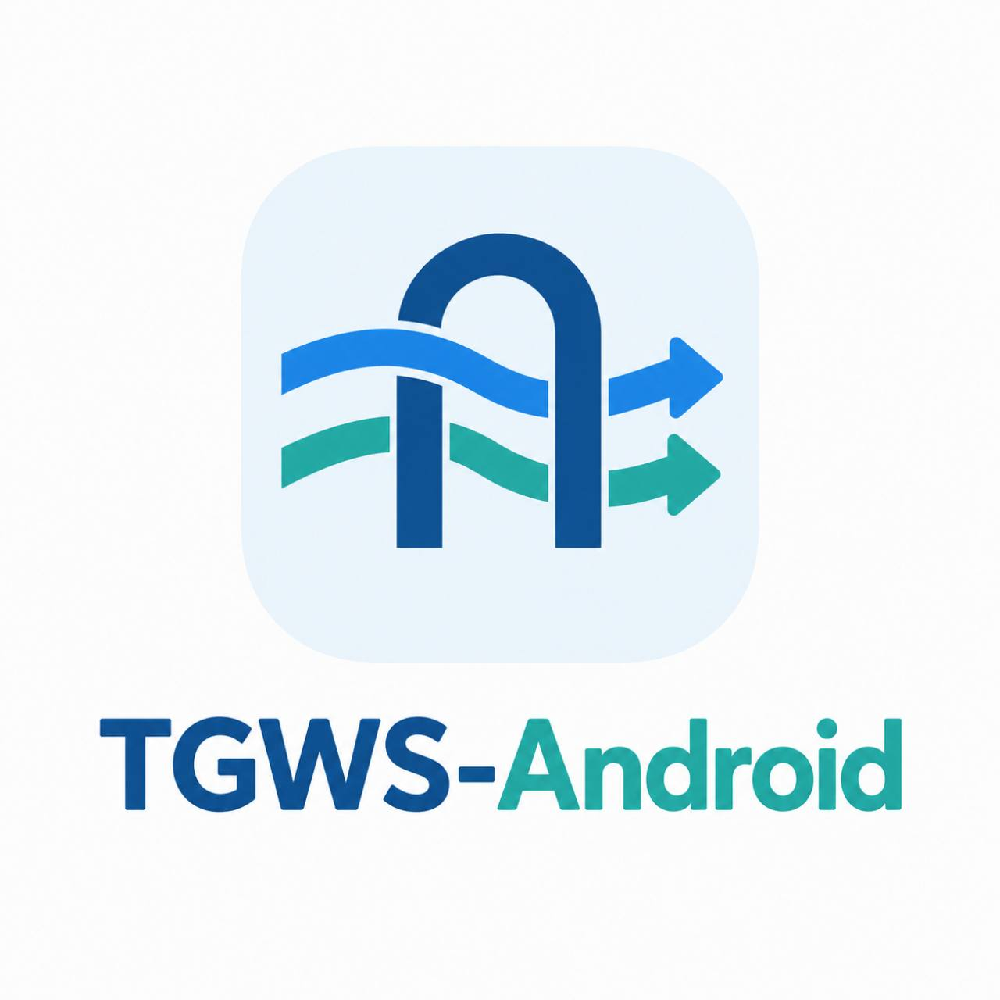

# TGWS-Android

[](https://github.com/Kust3r3nk0/TGWS-Android/actions/workflows/android-ci.yml)



**Unofficial, open-source Android 15+ port of [Flowseal/tg-ws-proxy](https://github.com/Flowseal/tg-ws-proxy).** Developed under **Makarov Lab's 3.0™**.

> **0.3.1-alpha test update. Owner physical-device validation: pending.** Automated checks do not establish carrier reachability. Earlier user reports cover Android 16 / Wi-Fi; the reported stable 6 ms on port 8443 in 0.2.0 is Telegram’s reading, not an independent measurement or a test of this version.

## 0.3.1 interface and DNS

Material 3 now has **Home** and **App & MTProxy settings** bottom tabs. Light/dark/system
themes persist, with a quick theme toggle in the top menu. Proxy configuration is preserved
and can be saved separately without starting the service.

Select **Cloudflare DNS over HTTPS** in settings for 1.1.1.1 / 1.0.0.1 and IPv6 bootstrap.
System DNS remains the migration/default choice. This is app-scoped and never changes Android
DNS. Home automatically shows Wi-Fi/cellular and IPv4/IPv6/dual-stack even when the proxy is stopped.
[DNS behavior and limits](docs/en/DNS_AND_APPEARANCE.md).

## Architecture & roadmap


*The diagram separates the current unverified alpha source snapshot from features planned for 1.0.*

## Goal

Build a native Kotlin / Jetpack Compose app exposing a local MTProto WebSocket proxy. This app is **not a device-wide VPN**. It targets Android API 35+ and will be developed towards feature parity with the upstream project's WebSocket, TCP fallback, Fake TLS, Cloudflare Proxy/Worker and HTTP/2 transports.

[Download 0.3.1 Debug APK](https://github.com/Kust3r3nk0/TGWS-Android/releases/download/v0.3.1-alpha-debug/TGWS-Android-0.3.1-debug.apk)

## 0.2.0 reliability

For a Cloudflare route without a VPS, see the [experimental Worker setup](docs/en/CLOUDFLARE_WORKER.md).
Your account is required; Megafon reachability is unverified. It has a 16 MiB
per-session budget and does not require a new APK or spoof `cloudflare.com`.

Bounded unused direct-WSS pool, pre-init Ping/Pong, age rotation and per-route
1–30 second backoff. Active MTProto sessions are never reused.
[Policy, soak and limits](docs/en/RELIABILITY_0.2.md).

## Mobile networks

If a carrier blocks Telegram IPs, direct WSS → TCP fallback can fail on both paths.
The app supports an optional **relay-only** route through your reachable
WSS endpoint. No external relay has been deployed or validated on a carrier yet.
[Setup, standalone server and limits](docs/en/MOBILE_NETWORKS.md).

## Current source snapshot

| Component | Status |
|---|---|
| Obfuscated2, AES-CTR, relay initialization | Implemented and tested: byte-for-byte JVM Flowseal v1.11.2 vectors |
| Abridged / Intermediate / Padded Intermediate | Implemented and tested: JVM, 4 MiB packet bound and malformed length rejection |
| Loopback listener and WSS → TCP fallback | Implemented and tested locally; live Telegram network validation required |
| WebSocket framing, Upgrade and TLS | Implemented and tested with local RFC 6455 / TLS peers; live WSS validation required |
| Foreground Service and network loss | Basic lifecycle tested on API 35–37 emulators; real Wi-Fi/LTE requires validation |
| Compose / Material 3, Russian and English UI | Implemented; device validation required |
| Keystore AES-256-GCM | Implemented and tested on API 35–37 emulators; lost keys require explicit recovery |
| Official Telegram physical-device E2E | Partial user verification of 0.1.0-alpha on Android 16 / Wi-Fi; update and network recovery require retesting |
| Debug APK | Debug-signed test artifact, not a distribution release |
| GitHub debug Pre-releases | Owner-authorized after CI, with debug signing and stated limitations |
| Trusted signed stable APK | Planned; full release gate not passed |

| Fake TLS and CF Proxy/Worker routing | Implemented and tested locally; external E2E unverified |
| HTTP/2 media `/api` | Real local TLS/ALPN/flow-control/multiplexing and RST/GOAWAY tests; needs compatible server |
| Network-bound DNS/sockets, IPv4/IPv6, network changes | Local/model tests; physical DNS64/XLAT and handover unverified |
| Network/route diagnostics and carrier reference | Actual phase timings, explicit probe, anonymous export preview; no APN/DNS/SIM changes |

[0.3 transports and configuration](docs/en/TRANSPORTS_0.3.md) · [Carrier reference/matrix](docs/en/RU_MOBILE_OPERATORS.md).
Seamless migration, test datacenters and full experimental Worker media flow control remain outside this release.

## Build prerequisites

Use Android Studio compatible with AGP 9.4.1, JDK 17, SDK `platforms;android-37.0`
and `build-tools;36.0.0`. The complete Gradle 9.8.1 Wrapper includes SHA-256 validation.

```bash
./gradlew --no-daemon :app:testDebugUnitTest :app:lintDebug :app:assembleDebug
./gradlew --no-daemon :app:assembleDebugAndroidTest
```

Run `:app:connectedDebugAndroidTest` with a device or emulator. CI checks pushes to
`main`, Pull Requests and manual runs; successful builds publish the debug APK,
checksum, build version/commit and changelog, with JVM/Lint reports separately.
Action versions are pinned to verified commit SHAs. A separate PR/manual workflow
executes all 22 instrumentation tests on each API 35, 36 and 37.0.
JVM tests, Lint and APK assembly are required checks. See [testing](docs/en/TESTING.md) and the
[update test report](docs/en/TEST_REPORT_0.3.1-alpha.md).

## Versions

Kotlin 2.4.21, AGP 9.4.1, Gradle 9.8.1, minimum Android 15 / API 35,
compile SDK 37.0, target SDK 37, JDK/bytecode target 17. Python is used only
as an upstream test reference and is not included in the APK.

## Alpha behavior

The listener binds only `127.0.0.1`, default port `1443`, after user action.
Local availability differs from pending and established transport sessions.
Neither an open port nor a session count proves Telegram message delivery.

TLS checks certificate trust and the `kwsN.web.telegram.org` hostname. Upstream
default WSS redirects use `149.154.167.220` for DC 2 and 4; other DCs use direct TCP.
Media tries `kwsN-1` before `kwsN`. Existing DC 203 remains a separate TCP route;
test DCs `10001–10005` are rejected. Fronting with disabled hostname verification
is excluded.

WSS checks an idle peer with Ping/Pong after 60 seconds instead of immediately
reconnecting. Partial-message assembly is bounded to 60 seconds, and MTProto
inactivity to 300 seconds. The UI shows WSS/TCP session counts and clears obsolete
fallback errors after a new connection succeeds.

Secrets are hidden by default; reveal, copy and link opening require user action.
Telegram links use `dd` for Padded Intermediate. An optional Fake TLS domain produces an `ee` + secret + HEX-domain link. This local record camouflage does not replace authenticated remote TLS or remove carrier IP blocking.
Lost Keystore keys never silently overwrite stored ciphertext. Diagnostic events
contain categories only. Network changes close sessions so Telegram can reconnect;
seamless migration is not supported.

## Roadmap and community

- [Feature parity roadmap](docs/en/ROADMAP.md)
- [Contributing](docs/en/CONTRIBUTING.md)
- [Security disclosure](docs/en/SECURITY.md)
- [License](LICENSE) / [Attribution](docs/en/NOTICE.md)

Upstream baseline: Flowseal/tg-ws-proxy **v1.11.2**, commit `307a384ab7f522e34bb1a045884d0bd90f40bee5`.

This is an independent community port, not an official Flowseal Android release. MIT licensed; original Flowseal attribution is preserved.

## Codex development and CI artifacts

To implement a specification with Codex, follow the [English Codex workflow](docs/en/CODEX_WORKFLOW.md) and [project agent instructions](AGENTS.md). The existing GitHub Actions workflow runs JVM tests, Android Lint and debug build checks for pull requests to `main`; after a successful run, download the `TGWS-Android-<version>-debug-<commit>` ZIP under **Actions → Android CI → Artifacts**. A successful CI run is not proof of real Telegram connectivity or production readiness.
