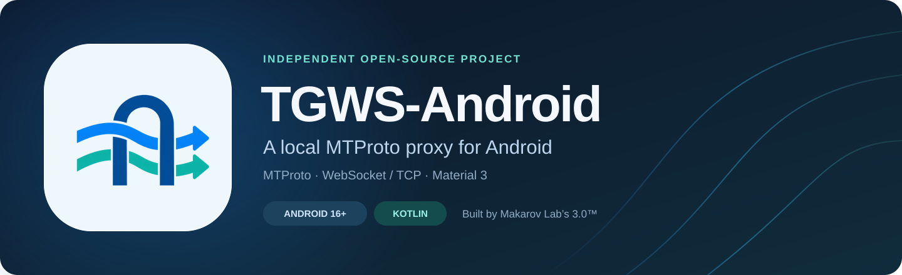
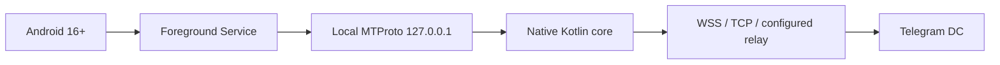

# TGWS-Android

<p align="center">
  
</p>

[](https://github.com/Kust3r3nk0/TGWS-Android/actions/workflows/android-ci.yml) [](https://developer.android.com/about/versions/16) [](https://kotlinlang.org/) [](LICENSE) 

**[Download Debug APK](https://github.com/Kust3r3nk0/TGWS-Android/releases) · [Русский](README.md) · [Roadmap](docs/en/ROADMAP.md) · [Contributing](docs/en/CONTRIBUTING.md)**

**Unofficial, open-source Android 16+ port of [Flowseal/tg-ws-proxy](https://github.com/Flowseal/tg-ws-proxy).** Developed under **Makarov Lab's 3.0™**.

> [!IMPORTANT]
> **0.6.1 — Connection Recovery for Android 16+.** Fixes reproducible setup-budget starvation of configured relays behind failed speculative routes. Debug Pre-release, not Production; device verification remains separate. [Fix and acceptance](docs/en/CONNECTION_RECOVERY_0.6.1.md).

[Release/signing/migration](docs/en/RELEASE_0.4.0.md) · [0.4.0 notes](docs/en/releases/0.4.0.md).

## 0.6.0 — Relay & Performance Update

Opt-in VPS Relay Manager, primary/backups, explicit checks, media-aware selection,
Node streaming/cleanup fixes and stable dependency updates. Settings/keys retained.
[Setup/acceptance](docs/en/RELAY_PERFORMANCE_0.6.0.md) · [VPS deployment](docs/en/VPS_RELAY.md).
Worker still has a 16 MiB session limit.

## 0.5.0 — Smart Connection Update

Opt-in Smart Routing, four network profiles, Connection Health, real traffic charts
and optional alerts. Existing encrypted settings and legacy behavior are retained;
only new sessions select permitted routes, with no migration/replay. [Setup,
limits and acceptance](docs/en/SMART_CONNECTION_0.5.0.md). Worker still has a 16 MiB
session limit; a fixed 0.4.2 module needs no redeploy.

## 0.4.2 — Relay Stability Fix

[Staged 0.4.2 → 0.5.0 → 0.6.0 contract and acceptance](docs/en/SMART_CONNECTION_UPDATE.md).

Reproducible connection cleanup, early backoff and network cancellation defects are fixed. The journal distinguishes HTTP Upgrade, safe Worker reasons and individual session closure. Worker limits remain in force; update **both** APK and Worker. [Audit and upgrade instructions](docs/en/RELAY_STABILITY_0.4.2.md). A test build does not certify external endpoint stability on a device.

## New 0.4.1 test update

Categorized errors, severity/category filters, route closure details, repeat limits, safe JSON reports and a one-shot local TCP port check. Diagnostics show the actual system WebView provider/version without starting an engine. [Changes and limits](docs/en/releases/0.4.1.md). CI passed: 270 JVM tests and 61 Android tests on each of API 36/37. [Diagnostics guide](docs/en/DIAGNOSTICS.md).

<table><tr><td></td><td></td></tr></table>

Actual API 36 CI-emulator screenshots: a deliberately occupied port and a real local listener check. The displayed provider is the installed version, not a latest-channel certification. [Provenance](docs/en/VERIFICATION_0.4.1.md).

## Languages & technology


| Language | Role |
| --- | --- |
| **Kotlin** | Native Android application, MTProto core, Jetpack Compose UI and tests |
| **JavaScript · ES modules** | Standalone WSS relay and Cloudflare Worker in `relay/` and `cloudflare-worker/` |
| **Python 3** | Protocol reference vectors, CI verification and publishing; **not bundled in the APK** |
| **Bash** | Android instrumentation and emulator preparation in CI |
| **AGSL** | Embedded Android RuntimeShader for Liquid Glass/transparency in `LiquidGlass.kt` |

**Resources & configuration:** XML for AndroidManifest, icons and localization; Kotlin DSL
for Gradle; YAML/JSON for workflows/server configuration. Java provides JDK 17; this project
currently has no separate Java source files.

**Platform:** Android 16+, Jetpack Compose / Material 3, Kotlin Coroutines, OkHttp,
Android Keystore, Gradle and GitHub Actions. [Image sources & licenses](docs/en/IMAGE_ASSETS.md).

## Premium Minimal in the app

<table>
  <tr><td align="center" width="33%"><strong>Home</strong></td><td align="center" width="33%"><strong>Diagnostics</strong></td><td align="center" width="33%"><strong>Settings</strong></td></tr>
  <tr><td></td><td></td><td></td></tr>
  <tr><td></td><td></td><td></td></tr>
</table>

Real **0.4.0 candidate** captures on API 36, Russian UI. The local listener is running; remote connectivity and measurements are not fabricated. [Source, checks and limitations](docs/en/VERIFICATION_0.4.0.md).

## Interface and system DNS

Transparency effect: a separate, persistent, off-by-default switch under Settings → Appearance. Cards and panels composite the real app backdrop; works with or without Liquid Glass. Text and controls stay opaque.

Liquid Glass beta: Settings → Appearance. Off by default; persistent frosted panels and navigation in both themes. Native procedural backdrop, no screen capture or continuous animation.

Material 3 has **Home**, **Diagnostics** and **Settings** bottom tabs with dedicated subpages. Light/dark/system
themes persist, with a quick theme toggle in the top menu. Proxy configuration is preserved
and can be saved separately without starting the service.

Built-in **Cloudflare DNS is removed**. The app uses the active Android network's DNS,
including system Private DNS and carrier DNS64 answers; other settings remain intact.
Bounded parallel IPv4/IPv6 TCP attempts stagger by 250 ms. Home automatically shows
Wi-Fi/cellular and address families even while stopped.
[DNS behavior](docs/en/DNS_AND_APPEARANCE.md) · [Network failures and options](docs/en/NETWORK_COMPATIBILITY_0.3.4.md).

## Architecture & roadmap



*The diagram shows the native path. External route reachability is verified separately.*

## Goal

Build a native Kotlin / Jetpack Compose app exposing a local MTProto WebSocket proxy. This app is **not a device-wide VPN**. It targets Android API 36+ and will be developed towards feature parity with the upstream project's WebSocket, TCP fallback, Fake TLS, Cloudflare Proxy/Worker and HTTP/2 transports.

[Download 0.4.1 Debug APK](https://github.com/Kust3r3nk0/TGWS-Android/releases)

## 0.2.0 reliability

For a Cloudflare route without a VPS, see the [experimental Worker setup](docs/en/CLOUDFLARE_WORKER.md).
Your account is required; Endpoint reachability depends on the active network. It has a 16 MiB
per-session budget and does not require a new APK or spoof `cloudflare.com`.

Bounded unused direct-WSS pool, pre-init Ping/Pong, age rotation and per-route
1–30 second backoff. Active MTProto sessions are never reused.
[Policy, soak and limits](docs/en/RELIABILITY_0.2.md).

## Mobile networks

If a carrier blocks Telegram IPs, direct WSS → TCP fallback can fail on both paths.
The app supports an optional **relay-only** route through your reachable
WSS endpoint. Individual endpoint reachability is not guaranteed.
[Setup, standalone server and limits](docs/en/MOBILE_NETWORKS.md).

## Network behavior and limits

- Fake TLS and plain Obfuscated2 with the same secret can share the local listener; invalid secrets are rejected.
- Large uploads/downloads renew deadlines on meaningful progress while retaining stall and memory limits.
- Suspension or per-app blocking of the same Android network closes stale sessions so Telegram can reconnect.
- The existing experimental Worker retains its 16 MiB/session cap. External endpoint reachability depends on the network.

[Fix plan](docs/en/ROADMAP.md). No embedded WebView; the network core remains native.

## Build prerequisites

Use Android Studio compatible with AGP 9.4.1, JDK 17, SDK `platforms;android-37.0`
and `build-tools;36.0.0`. The complete Gradle 9.8.1 Wrapper includes SHA-256 validation.

```bash
./gradlew --no-daemon :app:testDebugUnitTest :app:lintDebug :app:assembleDebug
./gradlew --no-daemon :app:assembleDebugAndroidTest
```

Run `:app:connectedDebugAndroidTest` with a device or emulator. CI checks pushes to
`main`, Pull Requests and manual runs; successful builds publish the debug APK,
checksum, build version/commit and changelog, with JVM/Lint reports separately.
Action versions are pinned to verified commit SHAs. A separate PR/manual workflow
is configured to run instrumentation tests on API 36 and 37.0; verify new run results.
JVM tests, Lint and APK assembly are required checks. See [testing](docs/en/TESTING.md) and the
[Developer checks](docs/TESTING.md).

## Versions

Kotlin 2.4.21, AGP 9.4.1, Gradle 9.8.1, minimum Android 16 / API 36,
compile SDK 37.0, target SDK 37, JDK/bytecode target 17. Python is used only
as an upstream test reference and is not included in the APK.

## Alpha behavior

The listener binds only `127.0.0.1`, default port `1443`, after user action.
Local availability differs from pending and established transport sessions.
Neither an open port nor a session count proves Telegram message delivery.

TLS checks certificate trust and the `kwsN.web.telegram.org` hostname. Upstream
default WSS redirects use `149.154.167.220` for DC 2 and 4; other DCs use direct TCP.
Media tries `kwsN-1` before `kwsN`. Existing DC 203 remains a separate TCP route;
test DCs `10001–10005` are rejected. Fronting with disabled hostname verification
is excluded.

WSS checks an idle peer with Ping/Pong after 60 seconds instead of immediately
reconnecting. Partial-message assembly is bounded to 60 seconds, and MTProto
inactivity to 300 seconds. The UI shows WSS/TCP session counts and clears obsolete
fallback errors after a new connection succeeds.

Secrets are hidden by default; reveal, copy and link opening require user action.
Telegram links use `dd` for Padded Intermediate. An optional Fake TLS domain produces an `ee` + secret + HEX-domain link. This local record camouflage does not replace authenticated remote TLS or remove carrier IP blocking.
Lost Keystore keys never silently overwrite stored ciphertext. Diagnostic events
contain categories only. Network changes close sessions so Telegram can reconnect;
seamless migration is not supported.

## Roadmap and community

- [Feature parity roadmap](docs/en/ROADMAP.md)
- [Contributing](docs/en/CONTRIBUTING.md)
- [Security disclosure](docs/en/SECURITY.md)
- [License](LICENSE) / [Attribution](docs/en/NOTICE.md)

Upstream baseline: Flowseal/tg-ws-proxy **v1.11.2**, commit `307a384ab7f522e34bb1a045884d0bd90f40bee5`.

This is an independent community port, not an official Flowseal Android release. MIT licensed; original Flowseal attribution is preserved.

## Codex development and CI artifacts

To implement a specification with Codex, follow the [English Codex workflow](docs/en/CODEX_WORKFLOW.md) and [project agent instructions](AGENTS.md). The existing GitHub Actions workflow runs JVM tests, Android Lint and debug build checks for pull requests to `main`; after a successful run, download the `TGWS-Android-<version>-debug-<commit>` ZIP under **Actions → Android CI → Artifacts**. A successful CI run is not proof of real Telegram connectivity or production readiness.


## WebView and owner testing

Current UI is native Compose: no embedded WebView or WebKit dependency. Provider inventory
in CI does not certify latest Stable/Beta. [WebView applicability](docs/en/WEBVIEW_COMPATIBILITY.md)
and [owner physical-testing workflow](docs/en/PHYSICAL_TESTING.md) define responsibilities.
Successful CI artifacts include version/source/tree SHA and `BUILD.md`; phone,
One UI, carrier, Telegram and Stable/Beta results are confirmed by the owner.

## Update Center

[Native app updates](docs/en/UPDATE_CENTER.md): GitHub Releases, explicit Stable/Preview channels, WorkManager and full APK signing verification, integrated into the existing settings.

[Native Update Center screenshots and automated verification (RU)](docs/UPDATE_CENTER_VERIFICATION.md).
