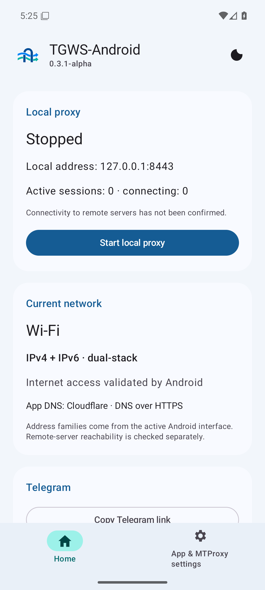
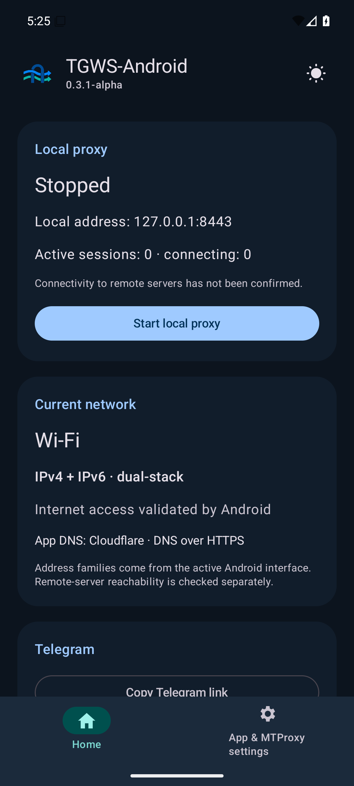
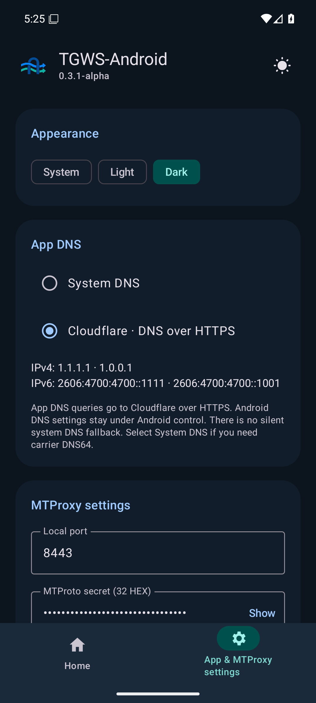

# Проверка 0.3.1-alpha

16 октября 2026 UTC. [English](en/TEST_REPORT_0.3.1-alpha.md).
Android 15+, minSdk 35, targetSdk 37, versionCode 7.
**Проверка владельцем на физическом устройстве: ожидается.**

## Изменения

Material 3: главная и отдельные настройки MTProxy, сохранение без запуска сервиса,
светлая/тёмная/системная темы с постоянным выбором и кнопкой переключения.
Сеть Wi-Fi/мобильная/другая и IPv4/IPv6/оба семейства видны даже при остановленном прокси.
Link-local не считается поддержкой интернет-семейства; это состояние интерфейса,
а не доказательство доступности удалённых узлов.

По умолчанию сохранён системный DNS. Выбираемый Cloudflare DoH действует внутри TGWS:
A/AAAA, числовой bootstrap, строгий TLS, конечные сроки и размеры, отмена при stop/смене сети.
Настройки Android DNS/APN/SIM не меняются. [Описание и ограничения](DNS_AND_APPEARANCE.md).

## Подтверждённые проверки

Исходный commit приложения: `38617572147d59b6aea521a99ce94b30dbd8a742`.
Документация может быть новее; application/build файлы совпадают с проверенным commit.

- Полная локальная Wrapper-команда с JDK 17: **BUILD SUCCESSFUL**, 181 JVM case,
  0 failures/errors/skipped, Lint 0 errors / 6 UseKtx warnings; оба APK собраны.
- [Android CI](https://github.com/Kust3r3nk0/TGWS-Android/actions/runs/38855362494): **SUCCESS**, фактические 181 JVM case без ошибок/пропусков,
  Lint и Debug APK; оба 60-секундных soak подтверждены по JUnit.
- [Матрица Android](https://github.com/Kust3r3nk0/TGWS-Android/actions/runs/38855362508): **SUCCESS**, API 35 — **22**, API 36 — **22**,
  API 37.0 — **22**. Проверены все **66** реальных JUnit cases: без missing,
  duplicate, failures, errors и skipped. Прежние 176 JVM и 19 Android cases сохранены.
- SHA-256 всех пяти ZIP-артефактов сверены с GitHub; PR merge tree совпадает с исходным.
  В подписанном APK совпадают все ZIP entry names и bytes с CI APK.
  В APK нет тестовых p12, keystore или Python-файлов.

DoH-тесты используют настоящий локальный TLS/H2: A/AAAA без системного bootstrap/fallback,
NXDOMAIN, повреждённый DNS, HTML, oversized response, redirect, недоверенный сертификат,
отмена и запоздалые ответы старой сети. Android дополнительно проверяет native DoH.
Явная отмена Dns.Call завершает ожидающий future; ресурсы уничтожаются при смене сети.
Старый тест повреждённого MTProto-пакета ожидает finally-close с deadline вместо гонки
с локальным EOF; протокольные проверки сохранены.

| CI soak | TCP/TLS/WSS | MTProto → TLS/H2 |
|---|---:|---:|
| Длительность, с | 60 | 60 |
| Завершённые пакеты | 26505 | 4954 |
| Завершённые сессии | 7251 | 988 |
| Искусственные сетевые сбросы | 59 | 59 |
| Ожидаемые разрывы при сбросах | 60 | 194 |
| Peak native sessions / лимит | 4 / 8 | 4 / 8 |

Peak подготовленных WSS 2/4; peak HTTP calls 4/16,
HTTP requests 6291. Gate проверяет реальные транспорты, reset,
длительность и границы ресурсов. Peers локальные; аккаунт Telegram не используется.

## UI и системные полосы

Проверены навигация с несохранённым портом, сохранение без запуска, пересоздание Activity,
темы/DNS и неизменность зашифрованного MTProto secret при смене публичных предпочтений.
Драйвер — стабильный UI Automator 2.4.0: Espresso 3.7 использовал удалённый Android 17
hidden API. Прокрутка выполняется публичным accessibility-действием страницы, учитывает
восстановленную позицию. Тесты и утверждения не отключены.

Визуальная проверка выявила светлые системные полосы при тёмной теме на API 35.
Исправлено стандартным AndroidX edge-to-edge, явными SystemBarStyle и синхронизацией
нативного фона окна с Material 3; добавлена проверка
реально отрисованного фона страницы и обеих системных полос. PNG ожидает стабильный кадр
и завершение цветового перехода Material 3. Test-only файлы сохраняются в shell-owned
Download и переживают удаление APK стендом; новых storage permissions нет.

Снимки финального API 36, английская локаль эмулятора; PNG не редактировались.
RU/EN содержат по 166 строк без отсутствующих переводов.

## Debug APK

Прежние applicationId `io.github.kust3r3nk0.tgwsandroid`, название `TGWS-Android` и
debug-сертификат `26877620e16c5b2680023fc1fc6a285214b2e06dc998366731d9bcacd11c9fbe` сохранены. Это не production signing.
SHA-256 подписанного APK: `26755af5f67875e5668c9d9ac7d7b0f165db7e7de4fbaed63866d831a6e0c363`.
Публикационный workflow повторно сверяет source, оба CI, JUnit, soak, подпись и payload.

## Ограничения

На одном снимке тёмной главной API 36 системные значки сохранили смешанный цвет после
переключения. Фон страницы/полос и элементы приложения проверены; контраст системных
значков на физическом Android 16 требует отдельной проверки. Это не проверка отсутствия
всех визуальных дефектов на устройствах производителя.

Физический телефон, публичный Cloudflare через оператора, мобильная сеть и Telegram
новой версии — **NOT TESTED**. Ранее сообщённый Wi-Fi E2E не подтверждает эту версию.
DNS не гарантирует обход IP-блокировки; Cloudflare не синтезирует операторский DNS64.
В IPv6-only может потребоваться системный DNS/XLAT. Прежний экспериментальный Worker
сохраняет лимит 16 MiB/сессию. Стабильный release gate не закрыт; debug-предрелиз
не обозначается как проверенный production-релиз.
