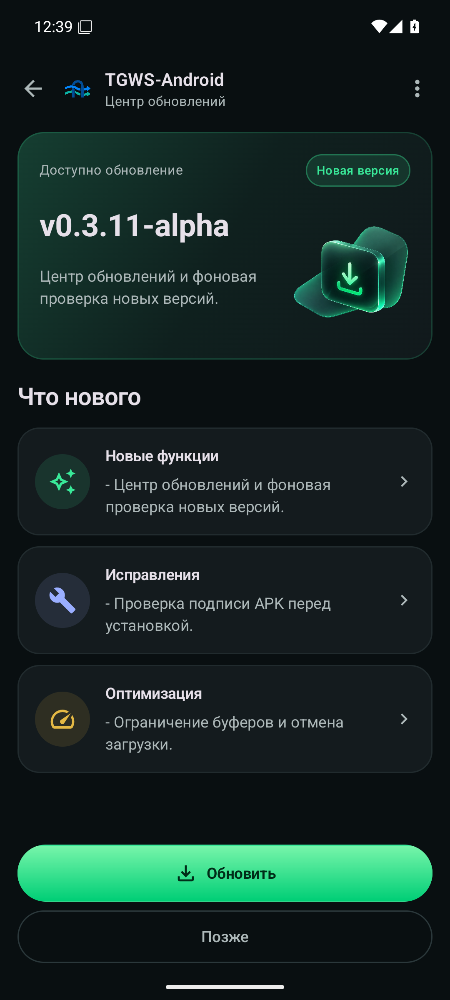
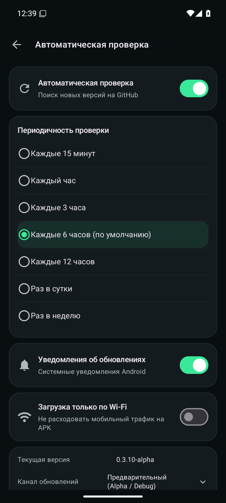

# Update Center 0.3.10-alpha: реализация и проверка

Android 16+ / API 36+, versionCode 16. [PR #19](https://github.com/Kust3r3nk0/TGWS-Android/pull/19) остаётся открытым для проверки владельцем. [Описание функции и формат релизов](UPDATE_CENTER.md).

## Реализованные возможности

- Два нативных экрана Compose / Material 3 по утверждённому концепту: тёмный зелёный вариант, светлая адаптация, реальные категории changelog, раскрытие текста, прогресс, отмена и повтор загрузки.
- Официальный GitHub Releases API, явные Stable/Preview, сравнение SemVer и versionCode, совместимость Android и документированный манифест assets. Ссылки из Release Notes не используются для установки.
- Уникальный WorkManager с семью интервалами, сохранением выбора и отменой расписания; независимые уведомления, Wi-Fi-only для загрузки APK, ручная проверка, история и backoff.
- Проверка SHA-256 и криптографической подписи всего APK; проверенная прямая ротация сертификата с правом installed-data, package/version/minSdk, узкий FileProvider и подтверждение Android. Разрешение установки запрашивается после проверки файла.
- Сохранение настроек прокси, секрета и Keystore. Фоновая проверка не меняет кандидата активной загрузки; повреждённый кэш можно загрузить заново. Сетевое ядро не изменено.

## Автоматические проверки

```bash
./gradlew --no-daemon :app:testDebugUnitTest :app:lintDebug :app:assembleDebug :app:assembleDebugAndroidTest
python3 -m unittest discover -s .github/scripts -p 'test_*.py'
python3 -m unittest discover -s .github/release -p 'test_*.py'
```

Локально выполнены 244 JVM-теста без ошибок и пропусков, 76 Python-проверок CI-скриптов и 5 проверок публикации. Lint: 0 ошибок, 20 предупреждений стиля и рекомендаций зависимостей. Debug APK и тестовый APK собираются через Wrapper.

Android-набор содержит 53 сценария на каждой из API 36 и 37. CI сверяет фактические JUnit-записи с исходниками и отклоняет пустые, неполные или пропущенные испытания. Проверяются Compose, переключатели, локализация, крупный шрифт, темы/прозрачность, восстановление Activity, уведомление и переход к центру, WorkManager, реальные подписи APK и системный установщик без подтверждения установки. Регрессия install -r с 0.3.9 проверяет секрет, шифротекст, Keystore, настройки прокси/оформления и обновлений.

[Результаты текущего PR](https://github.com/Kust3r3nk0/TGWS-Android/pull/19/checks). Для конкретного опубликованного APK source SHA, проверенный commit CI, результаты и checksum находятся в приложенных `build-info.json`, `BUILD.md` и `SHA256SUMS` в [GitHub Releases](https://github.com/Kust3r3nk0/TGWS-Android/releases). Отдельные 60-секундные сетевые soak-проверки, relay/Worker и проверки отсутствия WebView/старого DNS остаются обязательными.

## Настоящие снимки приложения

Изображения получены на эмуляторе API 36 в [Compose-прогоне](https://github.com/Kust3r3nk0/TGWS-Android/actions/runs/39348216792), UI commit `5f338108e1a35c33ed063a89d879ff6364a63fc3`. PNG скопированы без редактирования из артефакта с проверенным SHA-256. Состояние доступного обновления использует тестовые данные `0.3.11-alpha`; это не объявление такого публичного релиза. В обычном APK нет демонстрационного режима или вымышленных Release Notes.

| Центр обновлений | Настройки проверки |
|---|---|
|  |  |

[Светлое состояние актуальности](images/update-center/updates-current-light-api36.png) · [Светлые настройки](images/update-center/updates-settings-light-api36.png). Дополнительные снимки крупного шрифта и английского интерфейса находятся в артефактах Android CI. Экран настроек прокручивается, сохраняя области нажатия от 48 dp при разных размерах экрана и шрифта.

## Проверка на телефоне

1. Установите Debug APK поверх предыдущей совместимо подписанной версии, сохранив данные приложения. Проверьте прежний секрет и параметры прокси.
2. Откройте «Настройки → Обновления приложения», затем настройки проверки. Канал выбирается нажатием строки в информационной карточке. Для предварительных APK явно выберите Preview.
3. Смените интервал, отключите автоматику и выполните ручную проверку. Проверьте сохранение переключателей после перезапуска, светлую/тёмную темы и крупный шрифт.
4. При появлении следующего более нового совместимо подписанного релиза проверьте загрузку, отмену/повтор, Wi-Fi-only, системное разрешение и подтверждение установки. После обновления проверьте прежнюю конфигурацию и работу Telegram.

Результаты физических проверок и личные сведения остаются в чате; секреты и приватные URL передавать не нужно.

## Практические ограничения

- Время WorkManager приблизительное и зависит от Android, энергосбережения и сети. Отдельное системное разрешение/блокировка канала влияет на доставку уведомлений.
- Старые релизы без update-manifest.json не предлагаются автоматически. Чужая подпись не разрешается сменой канала; удаление приложения для обхода проверки не предлагается.
- После завершения процесса частичная загрузка начинается заново. Полностью сохранённый APK повторно проверяется по явному действию пользователя; установщик сам не открывается.
- Полная цепочка следующего публичного обновления и поведение One UI проверяются владельцем на телефоне. Автоматические результаты не обозначают production-релиз или физический тест.
- MTProto и UI остаются нативными; встроенного WebView нет. Проверка каналов системного WebView не подменяется эмуляторными данными. Существующий Worker сохраняет ограничение 16 МиБ на сессию.

## Изменённые файлы

Полный diff доступен во [вкладке Files changed PR #19](https://github.com/Kust3r3nk0/TGWS-Android/pull/19/files).

- [.github/release/publish.py](../.github/release/publish.py)
- [.github/release/test_publish.py](../.github/release/test_publish.py)
- [.github/scripts/check_apk_upgrade.py](../.github/scripts/check_apk_upgrade.py)
- [.github/scripts/create_update_fixtures.py](../.github/scripts/create_update_fixtures.py)
- [.github/scripts/create_update_manifest.py](../.github/scripts/create_update_manifest.py)
- [.github/scripts/run_android_tests.sh](../.github/scripts/run_android_tests.sh)
- [.github/scripts/test_run_android_tests.py](../.github/scripts/test_run_android_tests.py)
- [.github/scripts/test_update_manifest.py](../.github/scripts/test_update_manifest.py)
- [CHANGELOG.md](../CHANGELOG.md)
- [README.md](../README.md)
- [README_EN.md](../README_EN.md)
- [ROADMAP.md](../ROADMAP.md)
- [app/build.gradle.kts](../app/build.gradle.kts)
- [app/src/androidTest/java/io/github/kust3r3nk0/tgwsandroid/ProxyServiceInstrumentedTest.kt](../app/src/androidTest/java/io/github/kust3r3nk0/tgwsandroid/ProxyServiceInstrumentedTest.kt)
- [app/src/androidTest/java/io/github/kust3r3nk0/tgwsandroid/UpdateSecurityInstrumentedTest.kt](../app/src/androidTest/java/io/github/kust3r3nk0/tgwsandroid/UpdateSecurityInstrumentedTest.kt)
- [app/src/androidTest/java/io/github/kust3r3nk0/tgwsandroid/UpdateSystemInstrumentedTest.kt](../app/src/androidTest/java/io/github/kust3r3nk0/tgwsandroid/UpdateSystemInstrumentedTest.kt)
- [app/src/androidTest/java/io/github/kust3r3nk0/tgwsandroid/UpdateUiInstrumentedTest.kt](../app/src/androidTest/java/io/github/kust3r3nk0/tgwsandroid/UpdateUiInstrumentedTest.kt)
- [app/src/androidTest/java/io/github/kust3r3nk0/tgwsandroid/UpdateWorkInstrumentedTest.kt](../app/src/androidTest/java/io/github/kust3r3nk0/tgwsandroid/UpdateWorkInstrumentedTest.kt)
- [app/src/androidTest/java/io/github/kust3r3nk0/tgwsandroid/UpgradeInstrumentation.kt](../app/src/androidTest/java/io/github/kust3r3nk0/tgwsandroid/UpgradeInstrumentation.kt)
- [app/src/main/AndroidManifest.xml](../app/src/main/AndroidManifest.xml)
- [app/src/main/java/io/github/kust3r3nk0/tgwsandroid/GithubUpdates.kt](../app/src/main/java/io/github/kust3r3nk0/tgwsandroid/GithubUpdates.kt)
- [app/src/main/java/io/github/kust3r3nk0/tgwsandroid/MainActivity.kt](../app/src/main/java/io/github/kust3r3nk0/tgwsandroid/MainActivity.kt)
- [app/src/main/java/io/github/kust3r3nk0/tgwsandroid/UpdateCenterUI.kt](../app/src/main/java/io/github/kust3r3nk0/tgwsandroid/UpdateCenterUI.kt)
- [app/src/main/java/io/github/kust3r3nk0/tgwsandroid/UpdateDownloads.kt](../app/src/main/java/io/github/kust3r3nk0/tgwsandroid/UpdateDownloads.kt)
- [app/src/main/java/io/github/kust3r3nk0/tgwsandroid/UpdateInstaller.kt](../app/src/main/java/io/github/kust3r3nk0/tgwsandroid/UpdateInstaller.kt)
- [app/src/main/java/io/github/kust3r3nk0/tgwsandroid/UpdateModels.kt](../app/src/main/java/io/github/kust3r3nk0/tgwsandroid/UpdateModels.kt)
- [app/src/main/java/io/github/kust3r3nk0/tgwsandroid/UpdateOptionsStore.kt](../app/src/main/java/io/github/kust3r3nk0/tgwsandroid/UpdateOptionsStore.kt)
- [app/src/main/java/io/github/kust3r3nk0/tgwsandroid/UpdateRepository.kt](../app/src/main/java/io/github/kust3r3nk0/tgwsandroid/UpdateRepository.kt)
- [app/src/main/java/io/github/kust3r3nk0/tgwsandroid/UpdateViewModel.kt](../app/src/main/java/io/github/kust3r3nk0/tgwsandroid/UpdateViewModel.kt)
- [app/src/main/java/io/github/kust3r3nk0/tgwsandroid/UpdateWorker.kt](../app/src/main/java/io/github/kust3r3nk0/tgwsandroid/UpdateWorker.kt)
- [app/src/main/res/drawable-nodpi/update_download_glass.png](../app/src/main/res/drawable-nodpi/update_download_glass.png)
- [app/src/main/res/drawable/ic_update_auto_awesome.xml](../app/src/main/res/drawable/ic_update_auto_awesome.xml)
- [app/src/main/res/drawable/ic_update_download.xml](../app/src/main/res/drawable/ic_update_download.xml)
- [app/src/main/res/drawable/ic_update_speed.xml](../app/src/main/res/drawable/ic_update_speed.xml)
- [app/src/main/res/drawable/ic_update_wifi.xml](../app/src/main/res/drawable/ic_update_wifi.xml)
- [app/src/main/res/values-en/updates.xml](../app/src/main/res/values-en/updates.xml)
- [app/src/main/res/values/updates.xml](../app/src/main/res/values/updates.xml)
- [app/src/main/res/xml/tgws_update_paths.xml](../app/src/main/res/xml/tgws_update_paths.xml)
- [app/src/sharedTest/java/io/github/kust3r3nk0/tgwsandroid/UpdateFixtures.kt](../app/src/sharedTest/java/io/github/kust3r3nk0/tgwsandroid/UpdateFixtures.kt)
- [app/src/test/java/io/github/kust3r3nk0/tgwsandroid/UpdateHttpTest.kt](../app/src/test/java/io/github/kust3r3nk0/tgwsandroid/UpdateHttpTest.kt)
- [app/src/test/java/io/github/kust3r3nk0/tgwsandroid/UpdateRepositoryTest.kt](../app/src/test/java/io/github/kust3r3nk0/tgwsandroid/UpdateRepositoryTest.kt)
- [app/src/test/java/io/github/kust3r3nk0/tgwsandroid/UpdateSourceTest.kt](../app/src/test/java/io/github/kust3r3nk0/tgwsandroid/UpdateSourceTest.kt)
- [app/src/test/java/io/github/kust3r3nk0/tgwsandroid/UpdateVersionTest.kt](../app/src/test/java/io/github/kust3r3nk0/tgwsandroid/UpdateVersionTest.kt)
- [docs/UPDATE_CENTER.md](../docs/UPDATE_CENTER.md)
- [docs/UPDATE_CENTER_VERIFICATION.md](../docs/UPDATE_CENTER_VERIFICATION.md)
- [docs/en/CHANGELOG.md](../docs/en/CHANGELOG.md)
- [docs/en/ROADMAP.md](../docs/en/ROADMAP.md)
- [docs/en/UPDATE_CENTER.md](../docs/en/UPDATE_CENTER.md)
- [docs/images/ASSETS.md](../docs/images/ASSETS.md)
- [docs/images/update-center/updates-center-dark-api36.png](../docs/images/update-center/updates-center-dark-api36.png)
- [docs/images/update-center/updates-current-light-api36.png](../docs/images/update-center/updates-current-light-api36.png)
- [docs/images/update-center/updates-settings-dark-api36.png](../docs/images/update-center/updates-settings-dark-api36.png)
- [docs/images/update-center/updates-settings-light-api36.png](../docs/images/update-center/updates-settings-light-api36.png)
- [docs/licenses/MaterialSymbols-Apache-2.0.txt](../docs/licenses/MaterialSymbols-Apache-2.0.txt)
- [docs/releases/0.3.10-debug.md](../docs/releases/0.3.10-debug.md)
