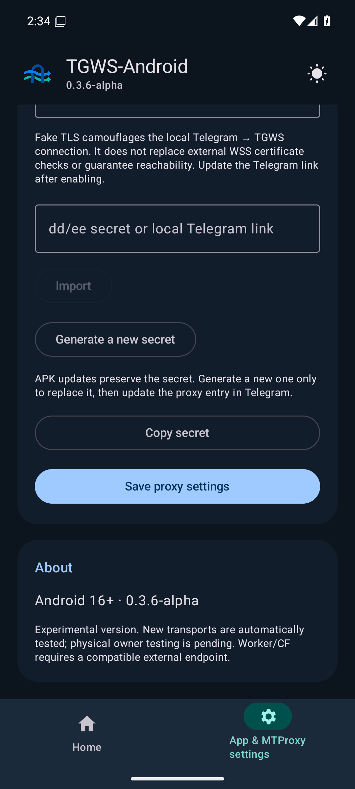

# 0.3.6-alpha verification

19 October 2026. Android 16+ / minSdk 36, versionCode 12, unchanged applicationId. Correct RU/EN minimum-OS labels and remove 34 retired platform files from the current tree; Git history remains intact.

Source `71fd2a2b886bdb423ed5823d5152c8d3967f2349`, checked PR tree `556fd3ea62df8eb1e7ebb435846e5ce1efc74b10`.
Passing [Android CI](https://github.com/Kust3r3nk0/TGWS-Android/actions/runs/39190171801) and [API 36/37 matrix](https://github.com/Kust3r3nk0/TGWS-Android/actions/runs/39190171835).

| Check | Observed result |
|---|---|
| Full Wrapper / JVM / APKs | 203 tests, zero failures/errors/skips; debug and instrumentation APKs built |
| Android Lint | Zero errors; 8 existing UseKtx warnings |
| Android 16 / API 36 | All 34 expected JUnit cases pass; 12 PNGs |
| Android 17 / API 37 | All 34 expected JUnit cases pass; 12 PNGs |
| In-place 0.3.5 → 0.3.6 upgrade | Both APIs preserve secret/ciphertext/Keystore/port/relay/mode/theme/effects |
| Platform contract | minSdk 36, RU/EN Android 16+ labels, supported CI APIs, actual APK manifest |
| Local relay / Worker | 11 / 17 tests; bundle dry-run without deployment |
| Python CI / publication guards | 64 / 5 tests |
| Native contracts | No retired Cloudflare DNS across 6 DEX files; native UI/MTProto, no embedded WebView |

Downloaded artifact ZIP SHA-256, exact JUnit identities/counts, zero skips, 24 PNGs, build metadata, owner handoff, environment before/after and upgrade JSON were checked. Two manual upgrade phases are additional to the 34 JUnit cases. The SHA-pinned baseline requires Android 16+; temporary CI signing preserves every ZIP entry. No data is cleared between installs; the publishing key never enters CI.

Separate 60-second local soaks: WSS/TCP 26,384 packets / 7,214 sessions / 59 resets; HTTP/2 5,283 packets / 1,033 sessions / 59 resets. Resource/completion gates passed; these are local peers, not external Telegram E2E.

## About screen

Unedited API 36 artifact `12158989722`, SHA-256 `6d630716c4bfa0f9964f2ca07665bbd28a6d8f4e1589adfb9b070a7778f5eccd`. API 37 was also inspected; tests check both locales and the actual visible label.

## Debug APK

[Download](https://github.com/Kust3r3nk0/TGWS-Android/releases/download/v0.3.6-alpha-debug/TGWS-Android-0.3.6-debug.apk) · [Pre-release](https://github.com/Kust3r3nk0/TGWS-Android/releases/tag/v0.3.6-alpha-debug).

Size 32,206,480 bytes. SHA-256 `063373a78944f23265fcee73558d7c5e5a0c2a8b08199ced920faac0fdc75cab`. Certificate SHA-256 `26877620e16c5b2680023fc1fc6a285214b2e06dc998366731d9bcacd11c9fbe`.
Preserved debug signing; apksigner and every-entry byte comparison with CI passed. Install over the previous debug release without deleting data. This is not production signing.

TGWS-16-016 inventory: `com.google.android.webview`, API 36 `133.0.6943.137`, API 37 `145.0.7632.218`, both `latest_verified=false`; One UI unverified. This does not certify current Stable/Beta. No unnecessary WebView/WebKit was introduced.

TGWS-16-017 physical Telegram/Wi-Fi/LTE/One UI/Stable/Beta validation belongs to the owner and remains pending for 0.3.6. Protocols, strict TLS, settings and the 16 MiB Worker limit are unchanged. Carrier reachability and HD upload are not established by this build. [Stable gate](STABILITY_GATE.md).
